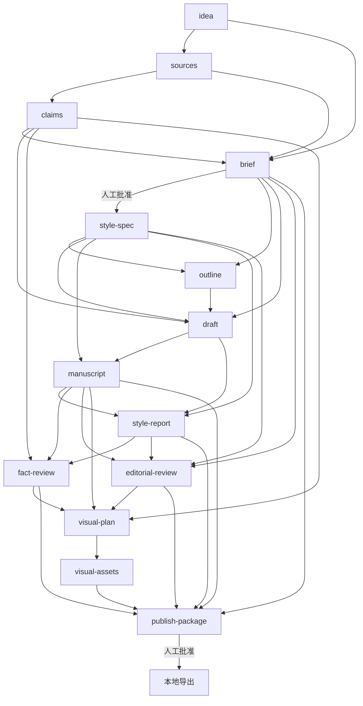

# 架构与实现边界

实现范围为 M0/M1：公众号长文、Artifact DAG、独立 Skills、本地状态、风格记忆。M2 真实试用和跨客户端行为验证、M3 发布与指标集成尚未实施。

## 资产依赖

唯一可执行定义在 resources/workflows/wechat-longform/workflow.yaml。new 固化该文件和哈希，不无声升级旧 run 的 DAG。

## 状态和写入

每条事件包含完整 Manifest，transitions.jsonl 是提交记录；manifest.yaml、approvals.jsonl 可重建。先追加事件并 fsync，再原子替换索引。末尾半条事件可修复，完整损坏事件报错。

每次操作持有 run 级 flock，进程退出后系统释放锁。文件写入使用临时文件、fsync、原子替换；put 的 expected-hash 防止覆盖已经观察到的手改。锁只能协调 CLI，不能阻止编辑器在最后一次比较后的极短窗口写入；本工具不是多编辑器事务系统。

手改更新 content_hash/revision，check 才登记 registered_hash 并保存只读快照。依赖变化精确传播 stale；review 还必须声明当前输入哈希，旧报告不能自动复活。

审批同时绑定哈希和资产 revision；改稿后恢复旧字节也需重新审批。交互终端确认是可审计流程，不是身份认证。

## 检查边界

确定性门禁检查 schema、来源字段、claim 引用、支持等级、哈希、本地链接、图片格式、包一致性和部分凭据特征。不会联网验证来源；本地通过不证明引用支持主张。

语义评审负责发现台账遗漏、偷换概念、虚构经历和风格含义变化；高风险主张与亲历由用户另行确认。

风格差异检查保护数字、单位、URL、引文、部分限定词、claim 标记和显式 protected_terms。字符串保持不能推出语义保持，不把有限测试称为“所有事实变化 100% 拦截”。

## 风格和交付

style 编译规则全文、版本与项目记忆快照。feedback 只建候选；用户确认的 promote/rollback 在项目锁内改变记忆并保存版本。

导出位置由项目 exports 配置决定，支持项目内任意普通目录，包括用户明确选择的 wiki/ 子目录。拒绝越界、符号链接及 Git、工具状态和客户端配置目录。已有目录只接受本 run 已记录且字节一致的幂等结果；部分导出失败保留现场，不自动覆盖。

`configure` 统一设置资料根、查重根、规则文件、作者资料、默认目标与场景；路径支持中文和空格。输出模板支持 `{run_id}`、`{date}`、`{slug}`、`{scenario}`。运行状态仍固定在隐藏的 .content-harness 中，避免迁移状态目录导致历史任务丢失。配置更新不搬动旧稿，也不自动摄入知识库索引。

场景是风格记忆的分组，与 workflow 解耦：一套长文流程可以分别积累 newsletter、product-notes 等场景的表达偏好。new 将场景固化到 run；旧 run 缺少 scenario 时继续以其 workflow 作为场景，保持兼容。

## 对早期设计的调整

- style-report 成为评审及发布包的必需依赖。
- 增加 put、package、confirm-author、verify-claim、restore、style-rollback，让写入和恢复可执行。
- style-spec 合并由 CLI 编译；正文风格改写仍由 Agent 完成。
- 资源置于 Python 包内，确保 wheel 不遗漏 Skills。
- M1 导出完整目录；不伪造尚未集成的 receipt、metrics 节点。
- 保留真实试用与效果评估为待办，不用合成测试替代。
