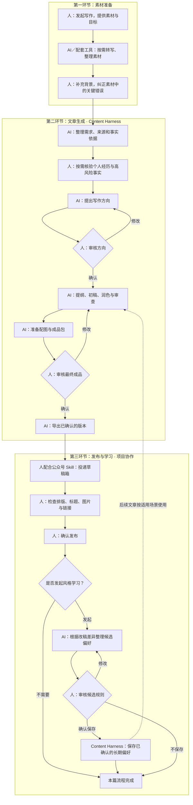
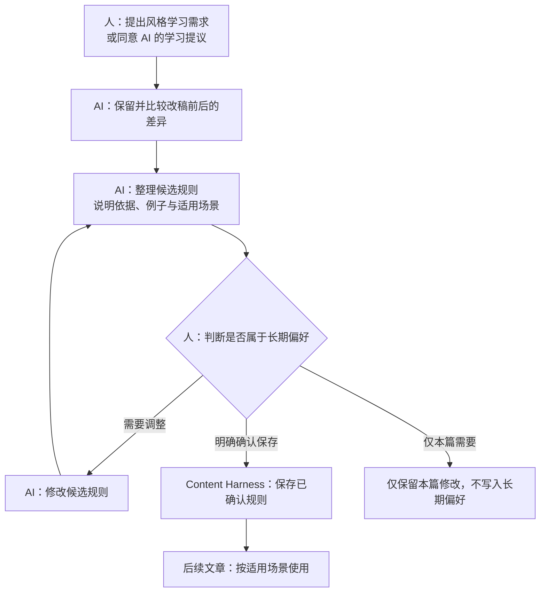
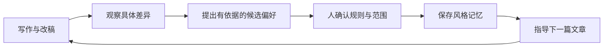

# 从素材到发布：人和 AI 协作的公众号写作流程

> PPT 内容底稿。以 `---` 分隔建议页面，流程图使用 Mermaid 格式。整体流程覆盖写作项目；Content Harness 负责文章生产与风格记忆，公众号草稿箱投递由项目中的其他 Skill 配合人完成。

## 01｜三个大环节

1. **素材准备**：人提供录音、转写稿、Markdown、笔记等，整理为写作输入。
2. **文章生成**：Content Harness 组织人和 AI 协作，完成资料整理、方向确认、写作、审查和成品确认。
3. **发布与学习**：人配合项目中的公众号 Skill 完成草稿箱投递与发布；按需开展风格学习，经人确认后保存长期偏好。

**人负责真实信息、表达意图和关键决定；AI 负责整理、生成、检查和执行。**

---

## 02｜整体流程图

说明：图中事实核验为按需环节；首次使用或作者说明变化时，还需确认作者说明。发布与学习是两项独立操作，学习不以公开发布为技术前提。

---

## 03｜第一环节：素材准备

### 输入可以是什么？

- 录音、访谈、分享会记录：先通过人工或配套工具转写。
- Markdown、读书笔记、已有草稿：保留原文与出处。
- 一个问题、一段观点或真实经历：由 AI 协助梳理。

### 人和 AI 如何配合？

| 人做什么 | AI／配套工具做什么 |
|---|---|
| 提供素材，说明写给谁、想表达什么 | 整理材料，提取主题、观点和待补充信息 |
| 解释背景，纠正关键转写错误 | 标记不清楚或缺少依据的内容 |
| 说明哪些经历可以使用、哪些内容不能公开 | 保留来源，准备可供文章生成使用的输入 |

**产出：可用素材、初步写作目标、表达与使用边界。**

录音转写属于素材准备能力，不应直接视为 Content Harness 内置功能。

---

## 04｜第二环节：文章生成

Content Harness 将写作过程组织为可保存、可检查、可继续的流程。

| 步骤 | AI 的工作 | 人的参与 |
|---|---|---|
| 1. 明确需求 | 整理主题、读者、目标、篇幅和边界 | 发起写作，补充关键信息 |
| 2. 整理依据 | 查资料、检查旧稿重复、整理事实与来源 | 按需核验亲历与高风险事实 |
| 3. 确定方向 | 展示核心观点、读者收获、范围与资料缺口 | **明确确认写作方向** |
| 4. 提纲与初稿 | 设定风格、搭建提纲、完成正文 | 可选审阅，随时提出意见 |
| 5. 润色与审查 | 检查事实、论证、作者口吻，修正问题 | 按需补充事实或提出修改 |
| 6. 配图与成品包 | 准备正文、标题候选、摘要、来源和必要配图 | **明确确认最终成品** |
| 7. 导出 | 导出已确认版本，说明文件位置 | 取用成品，进入发布环节 |

**默认不要求人逐步审批提纲、初稿和每次润色，但人可以随时介入。**

---

## 05｜审核机制：固定审批与按需确认

### 每篇文章的两个固定审批点

1. **写作方向确认**：确认观点、读者、范围和边界，再进入全文写作。
2. **最终成品确认**：审阅正文、标题、摘要和图片，再导出成品。

### 可能额外出现的确认

| 确认对象 | 触发条件 |
|---|---|
| 作者说明 | 首次使用，或作者说明发生修改 |
| 个人经历与高风险事实 | 存在待人工核验的内容，可批量或逐条确认 |
| 已确认对象的新版本 | 相关内容变化，需要重新审阅 |
| 长期风格偏好 | 希望将候选规则保存并用于后续文章 |
| 旧版风格偏好 | 希望恢复历史风格记忆 |

**两个固定审批点不等于整篇只会确认两次。**

AI 展示具体内容，人针对该对象明确表达决定。哈希和版本由 AI 与工具处理，人无需生成、复制或输入哈希。一般性的“继续”不能替代对具体对象的审批。

---

## 06｜第三环节：发布

### 由项目中的公众号 Skill 配合人完成

1. 使用 Content Harness 导出的成品。
2. 人配合公众号 Skill，将内容投递到公众号草稿箱。
3. 人检查标题、正文排版、图片、链接与最终展示效果。
4. 有问题先修改并复核；确认后执行发布。

### 能力边界

- **Content Harness**：生成、审查、确认和导出本地文章成品。
- **项目中的公众号 Skill**：承担草稿箱投递等发布协作，具体能力以该 Skill 为准。
- **人**：审核平台上的最终效果，决定是否公开发布。

本流程描述项目协作方式，不代表 Content Harness 内置公众号投递或自动发布能力。

---

## 07｜第三环节：风格学习

### 当前机制：按需发起，确认后保存

风格学习由人主动提出，或由 AI 提议、经人同意后开展。文章完成或发布，不会自动把本次修改写入长期偏好。

### 示例：从一次改稿到一条候选规则

- **改稿现象**：人将泛泛的结尾号召改成了一个今天可以执行的动作。
- **AI 提议**：“工作方法类文章的结尾给出一个具体行动。”
- **人判断**：这是长期偏好，还是本篇临时需要？适用于哪些文章？
- **确认后保存**：仅在适用范围内指导后续写作。

示例仅说明机制，不代表该偏好已经获得确认或保存。

---

## 08｜为什么后续文章能更符合你的表达习惯？

- 积累的是人认可的表达偏好，而非每一次修改。
- 偏好带有适用范围，避免将某类文章的写法套用到所有文章。
- 后续写作使用已确认的规则，人继续纠正不合适的表达。
- 这里的学习是保存与使用风格规则，不是训练或微调底层模型。

**目标：通过持续、可追溯的反馈，让文章逐步更符合作者的表达习惯。**

---

## 09｜人和 AI 的职责总结

| 环节 | 人负责 | AI／工具负责 |
|---|---|---|
| 素材准备 | 发起写作、提供真实材料、说明目标与边界 | 按需转写、整理素材、标记缺口 |
| 文章生成 | 确认方向、核验必要事实、审阅成品 | 研究、提纲、写作、润色、审查、配图与导出 |
| 发布 | 检查平台效果，决定是否发布 | 通过项目中的公众号 Skill 协助投递草稿箱 |
| 风格学习 | 决定哪些偏好值得长期保留及其范围 | 比较差异、提出候选、保存已确认规则并用于后续写作 |
| 过程管理 | 对具体内容作出明确判断 | 保存文件与状态、处理哈希和版本、更新受影响的检查 |

**人掌握表达与发布的决定权，AI 承担内容生产和过程执行。**

---

## 10｜能力说明与项目依据

- 文章生成顺序以 Content Harness 当前 workflow 为准。
- 公众号草稿箱投递属于所属项目的其他 Skill，不属于 Content Harness 内置能力。
- 风格学习是可选流程，候选偏好经明确确认后才保存；不应描述为每篇发布后自动完成。
- 本文为流程说明，不代表已完成真实公众号投递、跨客户端或真实模型试用验证。

项目参考：

- [新手上手指南](getting-started.md)
- [命令说明与确认机制](commands.md)
- [公众号长文工作流](../src/content_harness/resources/workflows/wechat-longform/workflow.yaml)
